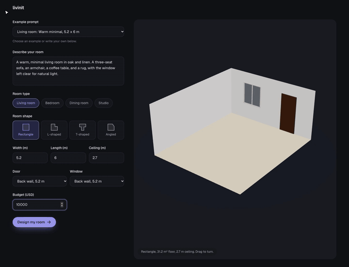

# Livinit room designer

Turn a room description, floor plan, and budget into three furnished 3D designs
using real catalog products. Supports living rooms, bedrooms, dining rooms, and
studios.

## The problem

Furnishing a room means finding pieces that work together, fit the space, and
meet a budget. A sofa can match the style but block a doorway. A dining set can
fit the floor plan but leave too little room to pull out a chair.

Livinit combines product selection with layout checks. It reads your brief,
searches the catalog, and arranges furniture around the room's dimensions,
doors, and windows. You can compare three designs, inspect their products and
prices, and save a choice in the browser.

The pipeline checks furniture overlap, access, required items, and cost. It can
swap or remove pieces that fail checks. Budget handling allows up to 10% over
the stated amount, with over-budget designs marked in the interface.

## Demo

The final 40 seconds of a living-room flow: compare generated designs, inspect
products, rotate the room, and save a design into Studio.

## Technical stack

| Layer | Technology and purpose |
| --- | --- |
| Web app | TypeScript, React, Vite, and Tailwind CSS for the brief, progress, comparison, and Studio screens. |
| 3D view | Three.js with React Three Fiber and Drei renders catalog models and their calculated positions. |
| Pipeline | Python, FastAPI, and LangGraph coordinate shared stages and parallel design branches. Server-sent events stream progress and results. |
| Models | Gemini interprets briefs, selects products, and reviews layouts. Jev ranks candidates and checks style and attributes. CLIProxyAPI supports alternative models. |
| Catalog search | PostgreSQL with pgvector searches prepared product embeddings, with filters for dimensions, categories, and prices. |
| Geometry and validation | Shapely, NumPy, and Python rules handle placement and clearance checks. Pydantic and Zod validate service and browser data. |

## How we reduce waiting

- Interpret the brief, analyze the room, and retrieve candidates once, then
  reuse that work across all three designs.
- Generate designs in parallel. Candidate ranking also runs concurrently
  across furniture needs and design directions.
- Use code for geometry, placement, and budget repairs. Reserve model calls
  for interpretation, product choices, and visual review.
- Use Gemini Flash with low thinking by default. Combine the final layout
  choice, review, and adjustments in one model call.
- Duplicate model calls that take longer than eight seconds and keep the first
  successful answer. This reduces some slow responses at the cost of extra calls.
- Stream each design as it finishes so users can inspect or save it while the
  others continue. Run placement and preview rendering in worker threads to
  keep the service responsive.

See the [pipeline overview](docs/pipeline/pipeline-overview.md) for the stage
flow, design rules, and delivery format.

## Benchmark (2026-10-11)

Six briefs (living room, Scandi living room, bedroom, dining room, studio,
relaxed studio), 3 runs each: 18 runs, 54 designs, on `main` with
`gemini-3.8-flash` at low thinking and Jev on. Times are pipeline times, not
browser 3D loading. Full report: [2026-10-11 report](docs/pipeline/report-2026-10-11.md).

### Delivery and speed

| | Median | p90 | Max |
| --- | ---: | ---: | ---: |
| First design ready | 21.5 s | 32.1 s | 51.0 s |
| All three designs done | 28.8 s | 42.4 s | 54.2 s |

All 54 designs were delivered, and all 18 runs finished under 60 seconds.

### Latency per step

| Step | Runs once per | Median | p90 | Max |
| --- | --- | ---: | ---: | ---: |
| 1 Interpret (Gemini) | request | 6.8 s | 12.0 s | 37.3 s |
| 2 Room (code) | request | < 0.01 s | < 0.01 s | 0.01 s |
| 3 Retrieve (vector search) | request | 1.3 s | 1.4 s | 1.8 s |
| 4a Rank (Jev) | request | 0.6 s | 0.8 s | 1.2 s |
| 4b Select (Gemini, checks, retries) | design | 6.5 s | 20.6 s | 29.1 s |
| 4c Place (code solver) | design | 0.7 s | 1.9 s | 2.7 s |
| 4d Finish (Gemini review, final check) | design | 4.7 s | 5.8 s | 12.5 s |

Select includes every retry turn; its p90 reflects briefs that need two to four
turns. The 37 s interpret time is a single slow Gemini response.

### Budget

Designs spend a median of **97%** of the budget. 47 of 54 spend at least 80%,
and none goes over the budget plus the 10% allowance.

### Reviewer scores

Scores from 1 to 5 by `gpt-6.1-sol`, averaged over the 9 designs per brief.

| Case | Prompt match | Style | Budget use | Completeness | Scale | Circulation | Grouping | Use of space | Focal point | Layout quality | Overall | Distinct |
| --- | ---: | ---: | ---: | ---: | ---: | ---: | ---: | ---: | ---: | ---: | ---: | ---: |
| Living room | 4.78 | 4.22 | 3.11 | 4.11 | 4.11 | 3.78 | 3.78 | 3.44 | 4.56 | 3.56 | 3.56 | 3.33 |
| Bedroom | 4.33 | 4.00 | 4.11 | 4.56 | 4.56 | 4.89 | 5.00 | 4.11 | 5.00 | 4.11 | 4.00 | 4.00 |
| Dining room | 4.22 | 4.78 | 4.78 | 3.00 | 4.44 | 4.56 | 5.00 | 4.67 | 5.00 | 4.22 | 3.89 | 3.33 |
| Studio | 5.00 | 4.89 | 3.33 | 3.00 | 4.22 | 3.78 | 3.67 | 3.00 | 3.89 | 3.00 | 3.00 | 4.00 |
| Scandi living room | 3.67 | 4.33 | 4.33 | 4.00 | 4.00 | 3.11 | 3.89 | 3.44 | 4.56 | 3.44 | 3.22 | 4.00 |
| Relaxed studio | 3.89 | 4.78 | 3.78 | 3.11 | 4.00 | 3.89 | 4.11 | 3.44 | 4.11 | 3.33 | 3.11 | 4.00 |
| **All cases** | **4.32** | **4.50** | **3.91** | **3.63** | **4.22** | **4.00** | **4.24** | **3.68** | **4.52** | **3.61** | **3.46** | **3.78** |

- **Selection:** prompt match, style, budget use, completeness, scale (pieces
  sized to the room).
- **Layout:** circulation, grouping, use of space, focal point, layout quality.
- **Overall:** the design as a whole. **Distinct:** how different the three
  designs of one request are.

At 9 designs per brief, differences under about 0.5 can be chance.
