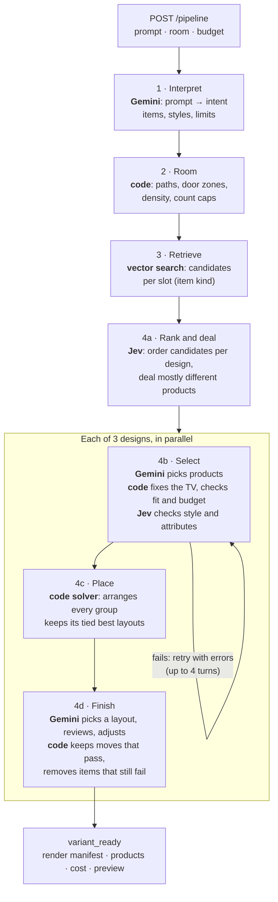

# How the pipeline builds a room

`POST /pipeline` turns a prompt, room geometry and budget into three furnished
designs, streamed to the browser as each finishes. This page describes `main`
as of 2026-10-11. Speed and quality: [2026-10-11 report](report-2026-10-11.md).
Adding a room: [adding a room type](adding-a-room-type.md).
Every step and rule in full: [pipeline details](pipeline-details.md).

## Flow

## Steps

| Step | Who | What it does |
| --- | --- | --- |
| 1 Interpret | Gemini | Reads the prompt: requested items and counts, sizes, colors, materials, exclusions, style hints. A TV stand is never a TV substitute. |
| 2 Room | Code | Walls, doors, windows, protected walkways, the furniture footprint range and count caps for the room size. |
| 3 Retrieve | Embeddings + Postgres | One search per slot: requested items, required room items, optional roles, decor. Price at most budget + 10%. When a request covers a required role, its other kinds still get a slot (side tables beside a requested coffee table). |
| 4a Rank | Jev | Orders each slot's candidates for each design's style direction, then deals them so the designs differ. |
| 4b Select | Gemini, code, Jev | Picks the products, then the checks below. The solver checks that everything fits. Retries with the errors, up to 4 turns. |
| 4c Place | Code | Solver places groups (bed, sofa, TV, dining, desk, singles) against walls, keeping doors and walkways clear. |
| 4d Finish | Gemini, code | Picks the best tied layout from top-down images and measured gaps, reviews it against the design rules, and moves pieces. Code keeps each move that does not make the checks worse, then removes any item that still fails. |

## Selection rules

- **What the model is asked for:** furnish the room to its size, spend 85-95%
  of the budget on better main pieces before extras, add design-only decor
  to suit the room size, and add up to 2 retail decor pieces with leftover
  budget. Minimal briefs stay minimal.
- **TV (code):** adds a TV when the brief asks for one or a stand is chosen,
  swaps a TV too wide for its stand, otherwise hangs it on the wall at eye level.
- **Checks:** budget, counts, required items, footprint floor, tabletop
  supports, reuse limit between designs (code); style match to the anchor and
  brief attributes (Jev); then the solver places the selection once, and any
  item it leaves out fails the turn (`LAYOUT FIT`).
- **Budget repair (code, no model call):** over 110%, swap for cheaper; under
  80%, swap for pricier toward 90% and never over 100%. Same category, same
  slot, pieces swapped, never added.
- **Last turn:** products that still fail are removed; items the solver cannot
  place stay for finish to remove. The design is still delivered.

## What never fails a design

A failed check removes the failing items; a failed review keeps the solver's
layout. A design fails only when a stage raises, such as a model call that used
all its attempts.

## Models

| Setting | Default | Note |
| --- | --- | --- |
| `LLM_DESIGN_MODEL` | `gemini-3.8-flash`, low thinking | Model for interpret, select and finish. |
| `LLM_STAGE_MODELS` | none | Per stage, e.g. `select=gemini-3.5-flash-lite:minimal`. |
| Non-Gemini model | - | A name like `claude-haiku-5-5` goes through the AI proxy; the level becomes `reasoning_effort`. About 2x slower, so not the default. |
| `MODEL_HEDGE_AFTER_S` | 8 | Sends a duplicate of a slow call; 0 turns it off. |
| `JEV_USES` | `rank,check` | Turns the two Jev uses on or off. |

Every setting is in `.env.example`.

## Limits

| Limit | Value |
| --- | --- |
| Designs per request | 3 |
| Selection turns | 4 |
| Budget | target 85-95%, floor 80%, ceiling 110% |
| Decor with leftover budget | up to 2 pieces |
| Model call | 60 s, up to 3 attempts |
| Jev call | 5 s, up to 2 attempts |
| Run deadline | 300 s |

## Output

Each `variant_ready` event carries the render manifest (model references and
poses), the product list, the total cost, and a top-down preview URL. Each run
writes a record to `pipeline/.data/runs/<run_id>.json` with stage timings, model
and Jev calls, notes and outcomes. Event fields: [delivery reference](../../pipeline/README.md#browser-delivery).
